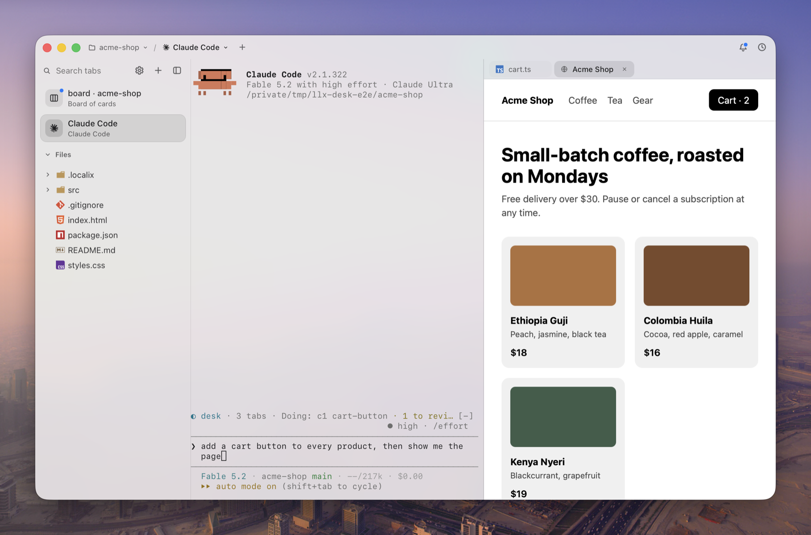
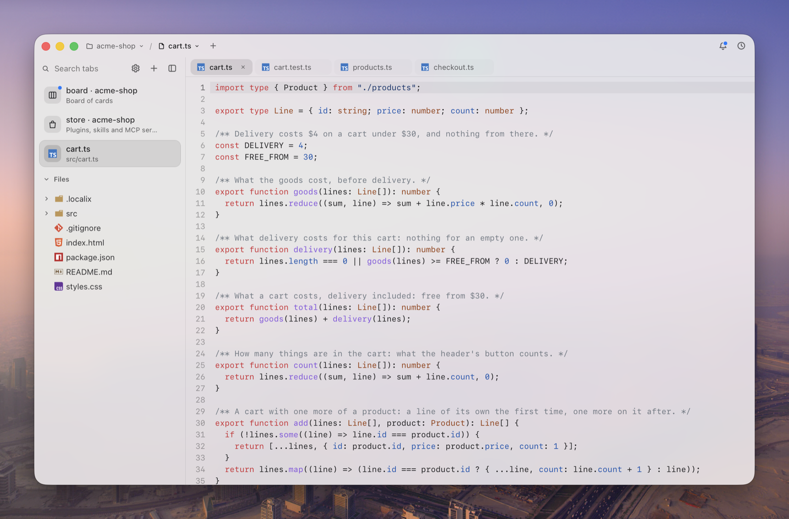
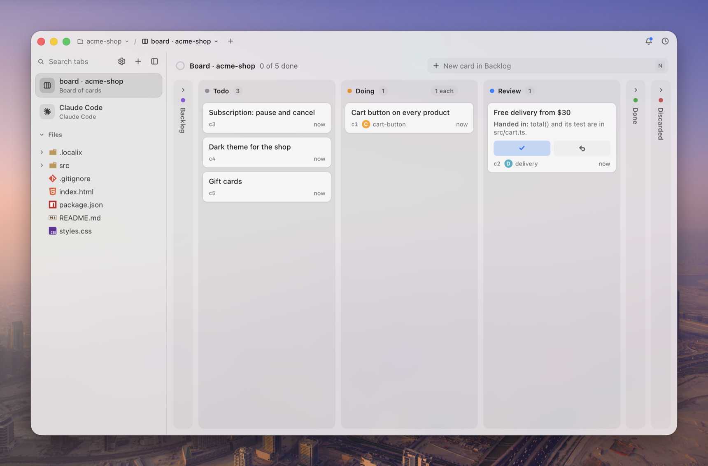
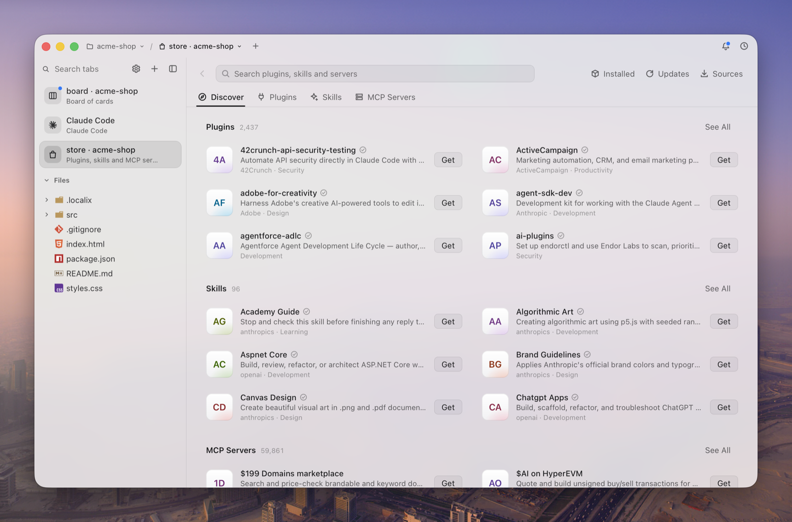

<p align="center">
  <picture>
    <source media="(prefers-color-scheme: dark)" srcset="assets/logo.svg">
    
  </picture>
</p>

<h1 align="center">Localix Terminal</h1>

<p align="center">
  <strong>The terminal for you and your coding agents</strong>
</p>

<p align="center">
  Terminal sessions that belong to a project and come back as you left them.<br>
  Claude Code, Codex or any CLI agent runs in them as it ships,<br>
  and uses the same browser, board and Store you do.
</p>

<p align="center">
  <a href="https://github.com/localixai/localix-terminal/releases/latest/download/Localix-Terminal-macos.dmg"><strong>Download for macOS</strong></a> ·
  <a href="#install">Install</a> ·
  <a href="#quick-start">Quick start</a> ·
  <a href="ARCHITECTURE.md">Architecture</a> ·
  <a href="CHANGELOG.md">Changelog</a>
</p>

<p align="center">
  <picture>
    <source media="(prefers-color-scheme: dark)" srcset="assets/window-dark.png">
    
  </picture>
</p>

<p align="center">
  <a href="assets/editor-dark.png"><picture>
    <source media="(prefers-color-scheme: dark)" srcset="assets/editor-dark.png">
    
  </picture></a>
  <a href="assets/board-dark.png"><picture>
    <source media="(prefers-color-scheme: dark)" srcset="assets/board-dark.png">
    
  </picture></a>
  <a href="assets/store-dark.png"><picture>
    <source media="(prefers-color-scheme: dark)" srcset="assets/store-dark.png">
    
  </picture></a>
</p>

## A terminal first

It is a terminal to use every day: your shell in real sessions that belong to a project and come
back as you left them. Coding agents are command-line programs, so they need nothing more:
Claude Code, Codex, Gemini CLI and the rest run here as their makers ship them, with their own
commands, sign-in and updates. Localix Terminal, open source, adds what a terminal alone lacks:
every session has a browser, a board and a Store beside it.

Agents work in the same window you do, in plain sight: you watch the page they test and the
terminal they type into, comment on what they got wrong, and take over at any moment. The app
has no model and no account of its own: the agents are the ones you already run.

## In the window

- **Terminal sessions**: real shells on a PTY. A coding agent running in one is a session: it
  shows the agent's mark and its title, and the files and pages opened in it are its own tabs.
- **Any CLI agent**: Claude Code, Codex, Gemini CLI, GitHub Copilot, OpenCode and Hermes find
  the window from the app's own terminals, with nothing installed into them.
- **A window agents can use**: an agent opens a page beside its terminal and clicks in it,
  drives a terminal, takes a screenshot, plans on the board and searches the Store, while you
  watch.
- **A browser**: real pages on the system WebView, at phone and tablet sizes, with comments you
  pin to an element and the agent hears.
- **A board**: the project's kanban. Hand a card to an agent, and it comes back to Review: only
  you accept.
- **A Store**: plugins, skills and MCP servers for Claude Code, Codex, Gemini CLI, GitHub Copilot
  and OpenCode; you are shown what an install writes and runs before it does.
- **Files and an editor**: the project's tree, live as an agent changes it, and its files in tabs.
- **Projects**: a project is a folder. Its sessions, tabs, history and board are its own, and it
  opens as you left it, even after a restart.
- **Native and local**: one small Rust program, no Electron, no account and no model inside;
  nothing listens on the network: commands come over a socket of your own user, and a page opened
  from disk is served on the loopback.

<details>
<summary>Each part in detail</summary>

- **Terminals**: real shells on a PTY, split and dragged like any tab; a coding agent running in one shows its mark and its session's title, and it is a session: the files and pages opened in it are its own, a row of tabs on the terminal's right with one in sight, so the side lists your sessions and each keeps its documents to itself. A file or a page asked from no terminal joins the session you look at, else the project's last; the row scrolls sideways when its tabs do not fit, a tab dragged along it stays where you leave it, and a tab that shows a file has the picture the tree gives that file. What a program asks its terminal to tell you (a notification: OSC 9, OSC 777) waits in the Event Center until you type in that terminal, and so does a command you typed that ran 30 seconds or more and finished while you were not looking ("Failed with 2 after 4m 12s"; Settings → Terminal → Finished commands). A terminal drawn again (a reload, a flood of output) keeps the modes its program set: focus reports, the cursor's shape and colour, the scroll region. ⌘F finds in a terminal's output, its scrollback too: every match lit, ⌘G and ⇧⌘G (or Return and ⇧Return) to walk them, Esc to close.
- **Agents**: Claude Code, Codex, Gemini CLI, GitHub Copilot, OpenCode and Hermes reach the window from its own terminals. They open pages and terminals, click by ref, plan on the board, and hear your comments; an Event Center tells you what waits for you. An agent that reports its state to its terminal (OSC 7501: Claude Code 2.1.295 and later, Codex), which every terminal of the app's answers that it reads, says there when it waits for you (an approval, a question, a sign-in) and when it failed: one line on its terminal, titled by the terminal with the agent's name beside its words, which stays in place until you type in that terminal and it goes on, however often it flips between working and waiting; a turn it finished is listed quietly until you type in its terminal, and while it works its tab's icon carries a still ring, with its share when it says how far. With its plugin, Claude Code also says when a long turn finished, with its last line. What waits also marks its tab with a dot and its words, counts on the Dock's icon, and, while you are in another app, comes as a silent macOS notice whose click shows the tab. A session that runs outside the window has no tab yet: its line's **Continue Here** (or its notice's click) continues it in a terminal of its project.
- **A browser**: real pages on the system WebView, with history, an address bar that knows the project's pages, phone and tablet sizes, comments you pin to an element, and ⌘F, which finds in the page as it finds in a terminal: a row under the toolbar, "3 of 12", every match lit and the page left as it was. A page that never comes (a dev server that has stopped) says so in one line and keeps its address, so ⌘R tries it again.
- **A board**: the project's kanban (Backlog, Todo, Doing, Review, Done, Discarded), kept in the project as `.localix/board.json` for git.
- **A Store**: plugins, skills and MCP servers for your coding agents in one searchable list (⇧⌘S). Pick one and install it into Claude Code, Codex, Gemini CLI, GitHub Copilot or OpenCode; before anything is written or run you are shown exactly what it would do.
- **Files**: the project's tree in the side, under its tabs. A folder is read when you open it and heard from the system (FSEvents, inotify) while it is in sight, so what an agent or you create, rename or delete shows as it happens, with nothing running while nothing changes. The folders you left open stay open. A double click or Return opens a file in a tab; its menu also offers **Open as Page** for HTML, **Open as Text** for SVG, **Open in Default App**, a terminal in a folder, and its path to copy. The menu makes a file or a folder, names an entry anew (F2) and moves it to the Trash (⌘⌫), the name written in the row itself. Drag an entry into another folder to move it, or out over a terminal to type its path there; nothing is ever written over, and what is refused is said under the entry.
- **An editor**: a file picked in the tree opens in a tab on the right of what you look at, the next one in its place. Syntax colours for the common languages, a script with no ending coloured by the program its first line names (`#!/bin/sh`); ⌘S saves the file as the disk wrote it (its line ends kept). A Markdown file opens drawn as a document, by [flowdown](https://flowdown.dev): the button in its corner, or ⇧⌘V, turns to its text and back, a link to another file of the project opens that file, and a picture is shown as its words, since the page loads nothing. A file changed on disk is followed while you have not edited it; where both changed, a save writes nothing and says so. What you left unsaved is kept with the file, past the tab and the app. Text up to 2 MB; a picture (SVG too), a film, a sound or a PDF opens as a page that shows or plays it, and what no page shows (an archive, a program) says so in one line.
- **Projects**: a project is a folder. Its tabs, history, board and events are its own, and it opens as you left it, even after a restart.
- **Windows your way**: Split View, several windows (⌘N), tabs torn off into their own window, a side that shuts to a rail, every shortcut yours to change.
- **Native and local**: one small Rust program, no Electron, no account and no model inside; nothing listens on the network: commands come over a socket of your own user, and a page opened from disk is served on the loopback.

</details>

## Install

**macOS 12+ on Apple Silicon**, or Linux with WebKitGTK. The app is all there is to install: it
holds the window and what connects your agents to it (the `llxterm` command, its MCP server and
the Claude Code plugin), and hands them to the agents in its own terminals. Nothing is written
into an agent's settings or your home.

```sh
curl -fsSL https://raw.githubusercontent.com/localixai/localix-terminal/main/install.sh | sh
```

On macOS that is **Localix Terminal.app** in `~/Applications`; or take
[`Localix-Terminal-macos.dmg`](https://github.com/localixai/localix-terminal/releases/latest/download/Localix-Terminal-macos.dmg),
open it and drag the app to Applications (it is signed and notarized by Apple). It is a regular
Mac app: Dock icon, menu bar, ⌘Q. Opened, it brings the window to you: what the project had
open, or, with nothing left open, New Page, New Terminal, Board and Open Folder… with their
keys, and under them the mark of each coding agent you have installed, which starts it in a
terminal (no terminal opens unasked).

Your agents reach the app only in its own terminals, and find it there with nothing installed;
outside Localix Terminal they are as you set them. `llxterm` is on the
`PATH` there (the app's own program, kept first even after your profile sets a `PATH`), and
`llxterm guide` prints how to use the window tool, a topic at a time (`llxterm guide commands`,
`pages`, `terminals`, `panes`, `board`, `files`, `person`, `store`; through MCP, the tool's
`guide` action); the window tool's description, the Claude Code plugin's short skills and
`llxterm window --help` all lead there. Each action is also a short command, and `+` joins
several into one call: `llxterm open localhost:3000 + click "Create account" + wait Welcome`
opens a page, clicks a button by its name and checks the result in one call; the first step
that fails or misses stops the rest and the command exits 1. Claude Code 2.1.280 and later loads the
plugin from the app's copy of it (`CLAUDE_CODE_PLUGIN_DIRS`; the comments mod needs 2.1.287),
unless your organization's managed settings turn plugin folders off. Gemini CLI 0.3 and later
and OpenCode get the window tool as an MCP server from a settings file of the app's that their
own variable names (`GEMINI_CLI_SYSTEM_DEFAULTS_PATH`, `OPENCODE_CONFIG`), merged with yours by
name; one you set yourself is left as it is. Gemini CLI starts no MCP server in a folder you
have not trusted in it: trust the project's folder there (`/permissions trust`) and the tool
appears. Codex, GitHub Copilot and Hermes find `llxterm` on the `PATH`. Each terminal also says which it is: `LLXTERM_PANE` (`t3`) and
`LLXTERM_PANE_PROJECT` (its project's folder), so a call from inside tmux there still lands
beside its terminal and in its project; and `LLXTERM_PROGRAM_STATUS=1`, that it reads what a
program reports of its state (OSC 7501), which the Claude Code plugin trusts only outside tmux
and screen (whose own terminal hears the report).

<details>
<summary>More install options</summary>

- The script checks `SHA256SUMS` before it writes anything; `LLXTERM_VERSION=0.1.0` picks another release.
- **Updates**: an app installed from a release updates itself. It downloads a newer release while you work, checks it as the script does (the checksum, and on macOS the Developer ID signature and the notarization), and installs it when you choose Restart to Update. A version that is ready is announced once, in a dialog that names both versions and lists what is new; Later puts it off, and its row under the toolbar comes back another day. Settings → Updates shows how far it is and can turn the looking off; a build from source is updated the way it was made.
- **Linux**: the program goes to `~/.local/share/llxterm`; `~/.local/share/llxterm/llxterm open` opens the app. Pages need WebKitGTK 4.1 and GTK 3 (`sudo apt install libwebkit2gtk-4.1-0 libgtk-3-0`), glibc 2.35+ (Ubuntu 22.04+), and a display (X or Wayland). Without one, terminals still work.
- **The app from source** (macOS): `cargo build --release && scripts/bundle-macos.sh` makes `target/release/bundle/macos/Localix Terminal.app`, signed ad hoc for this Mac.
- **From source**, Rust 1.89+ (on Linux also `libwebkit2gtk-4.1-dev` and `libgtk-3-dev`):

  ```sh
  cargo install --locked --git https://github.com/localixai/localix-terminal && llxterm open
  ```

</details>

## Quick start

1. **Open a project.** Open Localix Terminal and pick the project's folder with Open Folder…
   (⌘O). A project opens as you left it: its terminals, pages and board.
2. **Start your agent.** The empty window offers the coding agents you have installed: click
   one and it starts in a terminal of the project, already connected to the window. Or open a
   terminal (⌥⌘T) and run it as you always do.
3. **Ask for something you can see.** "Open the shop page and add an item to the cart": the page
   opens on the right of the agent's terminal, and you watch it click through.
4. **Point at what is wrong.** On the page press ⇧⌘C, pick the element, say what is wrong and
   send it with ⌘↩. The agent hears your words about that element.
5. **Plan on the board.** ⇧⌘B opens the project's board. The agent puts a task's parts on
   cards and hands each in to Review; you accept it or send it back with what is wrong. ▶ on a
   Todo card runs it by one of your agents, in a terminal of its own.

What waits for you (a question, a card in Review, a program that ended) is under the Event
Center's bell (⇧⌘E).

Agents work the window through one tool, `window`, which the app hands to each of them in its terminals.

<details>
<summary>What an agent can do in the window</summary>

- **Pages.** It opens a page beside its terminal: a dev server, a file of the project served as a site, or any address. It reads the page as an outline in which each control has a ref, and clicks, fills and picks options by those refs, never by where they are on the screen; it waits for the text that says something worked. A script it runs in the page returns a value, cheaper and surer than a picture; a screenshot is for how it looks. It can frame the page as a phone or a tablet.
- **What the page said.** A dialog and how it was answered (a page's `confirm` and `prompt` get Cancel unless the agent said to accept), a toast that came and went, a field that refused what was typed: each comes back with the page. A field the page refused reads `[invalid: why]`. An action waits up to 2 s for the requests it started.
- **Terminals.** It opens a terminal of the project for a program it must drive: a REPL, an installer's questions, another agent. It types into it and waits for the answer; in your shell the wait ends with the command and says its exit code. A wait on a password prompt ends at once and says so.
- **The board and the Store.** It plans on the project's board and hands its cards in for your review, and it searches the Store; what it asks to install is shown to you first.
- **You.** It can ask you, under the Event Center's bell, for what only you can do: sign in, a code from your phone, a decision. What you send from the window (a comment pinned to an element, what you do on the board) reaches it with its next step; Claude Code hears it at once.
- **Beside a pane.** It can open a terminal on the right of or under a pane of the project (`beside`, `side`), or a page or a file among that tab's documents, and your focus and the tab you look at stay as they are; `list` says which tab each of its panes is in and what lies beside it, and `show` with `zoom` fills a tab with one pane and back. Dividers and the keys between panes stay yours.
- **Its tabs.** What it opens belongs to the project it works in, and it closes them when it is done; Claude Code's close when its session ends.

</details>

<details>
<summary>How the board and the Store behave</summary>

**The board.** A project's board is kept in the app's database (`~/.local/share/llxterm/llxterm.sqlite`), so it outlives the app and every session reads the same one, and is written out to `.localix/board.json` in the project after each change, for git and for the plugin to read. A board kept in that file by an earlier version is taken in the first time it opens. A card is taken into Doing, handed in with a note of what was done, and accepted by the person into Done; the person can also drag cards, comment, edit, or send a card back to the top of Todo with what is wrong. A card waiting in Backlog or Todo can be run by one of your agents (▶ on a Todo card or on the open card, or Run With in its menu): the card goes to Doing as the agent's (`codex-c3`), and the agent starts in a terminal of the project on a first prompt that names its card and how to hand it in. A session in that terminal is that worker: it acts on the board under its name without passing it, and what you say of its card is told to it alone while its terminal runs. What the person does reaches the agent as comments do, gathered into one note once they pause. Each worker (the main agent, or one of its subagents) has at most one card in Doing, a limit the person can raise, and acts only on its own cards. A card handed in goes to Review as it is: only the person accepts.

**The Store.** One tab in a project lists what others published for coding agents: the plugins of the Claude Code and Codex marketplaces, Agent Skills, and the servers of the MCP Registry. The list is read from its sources when the Store is opened and at most once an hour after (the round arrow reads it now), kept in an index of its own (`~/.local/share/llxterm/catalog.sqlite`) and searched there as you type, so a search never leaves your Mac. A listing shows each agent you have and where it stands with it: Install, Update when a newer one is listed, Remove. An install first says what it would do, the file it writes or the command it runs, and asks for what the listing needs (a key, a token), which goes only into that agent's own configuration. A skill is copied to where the agent reads skills; an MCP server becomes an entry in the agent's list of servers; a plugin is installed by the agent's own program. The Store only removes what it put there. An agent can search and read the Store, and what it asks to install is shown to you the same way: nothing is installed on an agent's word.

</details>

<details>
<summary>The window: tabs, shortcuts and settings</summary>

The bar is one compact row, as crumbs beside the window's buttons: 📁 the project ⌄ / the tab ⌄ +. The project's crumb lists **Open Folder…** (⌘O), every project you used (a dot: an agent did something there), and **Close Project** (⌃⌘W); ⌃⌘P opens it. Open Folder… and the question before quitting with programs still running come down from the window as a sheet, and the pages and agents go on while it waits; with the window put away, they are an alert of their own. The tab's crumb lists the project's tabs. "+" after them opens a new tab of the project. Then the window's buttons: the Event Center (⇧⌘E; a dot on it says something new wants you) and history. A page has its own toolbar over it: back, forward, reload, the address field, its size and comments. A project you come back to opens as you left it: its pages, a shell in each of its terminals' folders with the last screen above, its board. A coding agent that ran in one of those terminals goes on there: a dimmed line says "Resumed Claude Code session" (with "permissions skipped" when you had skipped them), and the command that resumes that same session is typed into the shell (Claude Code, Codex, GitHub Copilot, OpenCode; never a prompt, a one-shot run or Codex's sandbox bypass), only into the shell itself at a prompt you have not typed at, with nothing running. One that does not resume is tried once more, then waits in the Event Center with Retry; one whose session is not known, or whose shell was busy, waits there with Continue. Your click types it once the shell is in front with nothing running, even in a shell that marks no prompt (fish, tmux); a second click starts nothing more. An agent that ends well at once, or one you start there yourself, takes the line away. Settings → Terminal → Resume agents turns it off. The window shows one project's tabs only: one with nothing open shows no tab, never another's, and what you type goes to the project you are in. Its history (⌘Y) lists its own closed tabs, and the address field suggests its own pages. The project's pages, terminals, board and Settings are a column on the left (drag its edge to resize, drag a tab to reorder, ⌃⌘S shuts it to a rail). **Split View** (⇧⌘\, a tab's menu, or a tab dragged from the column onto the pages) makes one tab of several panes: the tab shown and the next of the project's side by side, or the tab dragged beside the pane you let it go over, on the side of the edge it is nearest (left, right, above or below); a tab of panes side by side and one above the other is drawn as its tree is kept, every pane in its place. **Split Right** (⌘D) and **Split Down** (⇧⌘D) open a new terminal beside the pane in use, in the folder its shell is in (beside a page or a file: the project's), and it takes the keys; "+" → Split Right with… or Split Down with… starts an agent there instead. A split that would leave a pane too narrow is greyed in the menu. A session takes more terminals this way, and the tab keeps one row of documents for all of them, listed in the column by its terminal in use. Its panes are listed in the column as one row: a click in a pane makes it the one in use (it has the toolbar and the keys), drag any line between panes to resize, side to side or up and down, double-click it to even its panes. The Pane menu does the same from the keyboard: ⌥⌘ and an arrow moves the keys to the pane that way (of two, the one you used last), ⌥⌘] and ⌥⌘[ to the next and the one before, ⌃⌘ and an arrow moves the nearest divider that way (⇧ for a longer step), ⌃⌘= makes the tab even, ⇧⌘↩ zooms the pane in use (it fills the tab's part, the other panes put by and still running, the tab's row and its crumb marked with how many are hidden; ⇧⌘↩ again, a new split, a pane closed, a divider moved or a way to another pane draws them all again, while ⌥⌘] and ⌥⌘[ take the zoom to the next pane), ⌘W closes the pane in use (the pane you used last takes the keys; the last pane closes the tab), and Move Pane to New Tab (also in a pane's menu, and ⇧⌘\ in a tab of several panes) puts the pane in use in a tab of its own. Over a file, ⌘D and ⌥⌘↑ ⌥⌘↓ are the Pane menu's, not the editor's. Another tab picked shows alone; any of its panes picked again shows the tab as it was, as does coming back to the project or reopening the app. ⌘N opens another window, each with its own tabs, its own side and its own split. Drag a tab past the edge of its window and it becomes a window that follows the pointer; let go over another window's list and it goes in there. Closing a window closes its tabs. After a restart the other windows' tabs gather into the first. A terminal running a coding agent (Claude Code, Codex, Gemini CLI, GitHub Copilot, OpenCode, Hermes) shows the agent's mark and, under its name, the title its session sets. "+" opens a page, a terminal, the board, or one of those agents installed on your `PATH`.

Split proportions are kept across project switches and restarts. Sidebar and divider resizing
can be cancelled with Escape; focus an edge or a divider and use the arrows along it
(Left/Right, Up/Down for a divider between panes one above the other; Shift for larger steps),
or Home to restore the default width or even its panes. Board updates preserve an active card
drag or IME composition instead of replacing its DOM underneath the interaction.

Terminals support ANSI colors, 256 colors and truecolor. They use their own terminal identity and
color capabilities rather than the calling agent's captured-output settings, so inherited
`NO_COLOR` or `FORCE_COLOR=0` does not make a new terminal monochrome. macOS tools such as `ls`
get `CLICOLOR=1`. You can still opt out in your shell profile or for one command, for example
`NO_COLOR=1 command`.

**tmux inside Localix Terminal.** A terminal says it is `xterm-256color` with true colour, and
`llxterm` and its version to a program that asks (XTVERSION). tmux gives a terminal it does not
know the features its `TERM` names, so tell it what this one draws, in `~/.tmux.conf`:

```sh
set -g default-terminal "tmux-256color"  # where `infocmp tmux-256color` finds it; else screen-256color
set -g mouse on                           # Option-drag still selects text
set -g focus-events on                    # programs in tmux hear the window come and go
set -g set-clipboard on                   # copy mode reaches the pasteboard (OSC 52)
set -g allow-passthrough on               # a program that wraps its sequences for tmux reaches the terminal
set -as terminal-features 'xterm-256color:RGB:usstyle:overline:strikethrough:hyperlinks:sync'
```

The last line turns on curly and coloured underlines, overline, strikethrough and links
(OSC 8). It is matched by `TERM`, so it applies to every terminal that says `xterm-256color`.
Inside tmux the shell's command marks stay in tmux: no finished command is told from there.

| Keys | Does | Keys | Does |
| --- | --- | --- | --- |
| ⌘1…⌘8, ⌘9 | the project's tab by its place (one setting for the row), the last | ⌘L | address field |
| ⇧⌘], ⇧⌘[ | next, previous tab | ⌘R, ⌘[, ⌘] | reload, back, forward |
| ⌘T, ⌥⌘T, ⇧⌘B, ⇧⌘S | new page, terminal, board, Store | ⇧⌘M | page size |
| ⌘N | new window | ⌘F, ⌘G, ⇧⌘G | find in a terminal's output or a page, the next and the previous match |
| ⌘W, ⇧⌘T | close the tab (in a tab of several panes, the pane in use), reopen the last closed | ⇧⌘C, ⌘↩ | comment on the page, send |
| ⇧⌘A | search the tabs | ⌘Y, ⇧⌘E | history, Event Center |
| ⌘, | Settings | ⌘M | put the window away |
| ⌘O | open a folder as a project | ⌃⌘P, ⌃⌘W | switch project, close the project |
| ⇧⌘\ | split view: the tab beside the next one of its project; in a tab of several panes, the pane in use to a tab of its own | ⌘D, ⇧⌘D | a new terminal right of, or under, the pane in use, in its folder |
| ⌥⌘←→↑↓ | the keys to the pane that way | ⌥⌘], ⌥⌘[ | the next pane, the one before |
| ⌃⌘←→↑↓ | move the divider beside the pane in use (⇧ for a longer step) | ⌃⌘= | make the tab's panes even |
| ⇧⌘↩ | zoom the pane in use over its tab, and back | ⇧⌘O | open the page in your default browser |

In a terminal: ⌘F opens a find row under it (Return and ⇧Return walk the matches, Esc closes it and gives the keys back), ⌘K clears (a full-screen program such as an editor or tmux keeps its screen), ⌘← ⌘→ line start and end, ⌥← ⌥→ words, ⌘⌫ ⌥⌫ delete to the start and a word, ⌘↑ ⌘↓ top and bottom. ⇧↩ sends LF, a new line in a coding agent's prompt instead of submitting, and Enter at a shell. Option types your layout's characters until Settings → Terminal makes the left, the right or both Option keys Meta (⌥B and ⌥F move by words in a shell, as Alt does; ⌥↩ sends ESC CR). Option-drag selects text even where a program took the mouse, rather than a column. A program can copy to the pasteboard (OSC 52, as tmux and vim over ssh do) from the terminal you are typing in, up to 1 MiB of text; no program can read the pasteboard.

**Settings** (⌘, or the gear at the top of the column): theme, how much of the desktop the glass lets through, the interface and code fonts, the terminals' font size, which Option key is Meta in a terminal (left, right, both or neither), whether agents resume in their terminals, how long a command runs before its end out of sight is told (or never), and every shortcut: click its keys and press new ones (⌫ takes it off; one already taken asks first), reset one or all. They apply at once and are kept in `~/.config/llxterm/settings.json`.

</details>

<details>
<summary>Configuration</summary>

| Variable | Meaning |
| --- | --- |
| `LLXTERM_HOME` | Where the app keeps its log, screenshots and comments. |
| `LLXTERM_NO_WINDOW` | Terminals only: the app runs with no window. |

A password an agent should type but not see is saved once as a secret, which the agent asks you to do; it is kept in `~/.config/llxterm/secrets/` (0600), and the agent only ever sees its name.

</details>

<details>
<summary>The app's life</summary>

One app runs per user: opening it again brings its window. It opens as an ordinary window: a click on it activates the app, the green button zooms it to the available desktop area and restores it on the next click, and the yellow button (or ⌘M) puts it away: nothing of it is on screen, its pages keep drawing and your tabs stay, and the Dock icon brings it back. Nothing an agent does brings it back or puts it away. When an agent needs the window and the app is not running, it starts in the background and never takes your keys. The main window's close button quits, as ⌘Q (or the Dock's Quit) does: it asks first while terminals run a program, then ends everything. Its log is `app.log` in its home.

</details>

<details>
<summary>Security</summary>

Localix Terminal has no approval prompt of its own: **the agent's permission to use the window is the approval.** Allowing it lets an agent open pages, run scripts in them and start programs as you. Scope it as you would a shell.

- The app takes commands only on a unix socket (0600) in a 0700 directory, and serves only the user's own processes. Nothing listens on the network. The one TCP port is on the loopback (127.0.0.1, a port the system picks), open from the first page a window opens from disk until that window closes: see the next point.
- Pages are untrusted. A per-run token keeps a page from answering for the probe script. Only `http` and `https` load, plus your project's files served on loopback under an unguessable prefix (no dot-files, nothing outside the project, and only to a request that names that address).
- A page sees anything you are signed in to in this WebView. Do not let an agent type real passwords or card numbers it can read, or buy, book or submit personal data, unless you asked for exactly that.
- Dialogs are never accepted on a page's say-so: `confirm` and `prompt` get Cancel unless the agent says to accept.
- Passwords the agent should not see are saved secrets: the app types the value, and the agent sees only its name. Screenshots show what the page draws.
- A key an answer would carry (a GitHub, cloud, Stripe, Slack, GitLab, npm or model API key, a signed token, a private key) is shown to the agent as `[hidden: GitHub token]`, known by its shape. What you see in the window is not changed.
- A terminal an agent opens runs with the agent's environment, but for the variables that only say which session called, which its integration names.
- Screenshots are files in the app's home; the newest 30 are kept.

</details>

## More

[ARCHITECTURE.md](ARCHITECTURE.md) · demo sites in `demo/` · the landing page and docs site in `site/`

MIT, see [LICENSE](LICENSE).
